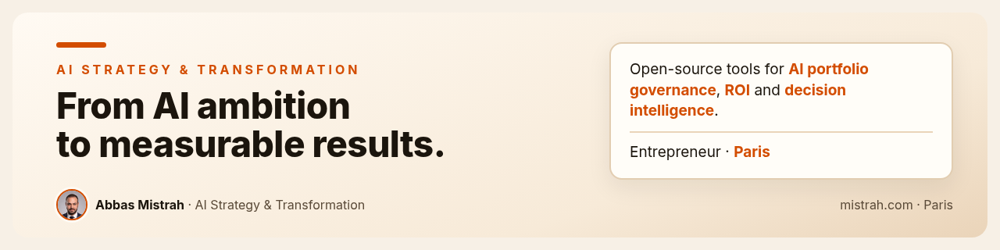

  

  <a href="https://mistrah.com">mistrah.com</a> ·
  <a href="https://medium.com/@abbas_mistrah">Medium</a> ·
  <a href="https://www.linkedin.com/in/abbas-mistrah-b0b53119a">LinkedIn</a> ·
  <a href="https://x.com/Abbas_Mistrah">X</a> ·
  <a href="https://orcid.org/0009-0009-5944-585X">ORCID</a>

## AI Strategy & Transformation

I help leadership teams turn AI ambition into **measurable, trusted results**.

A strategy for AI is not a list of use cases. It is a decision system: **where to focus, who decides, what to measure, what to refuse, and how a pilot becomes a run.**

Based in Paris. The repositories below are the open-source side of my work: tools that make AI portfolios governable and their value provable.

## Selected projects

| Project | What it does |
|:--|:--|
| [**boussole**](https://github.com/abbas-mistrah/boussole) | Enterprise AI Transformation Intelligence: govern the portfolio, drive adoption, measure ROI and prove value. |
| [**strategy-os**](https://github.com/abbas-mistrah/strategy-os) | Transformation Intelligence & ROI: design strategy, track execution, measure impact, attribute value and prove ROI. |
| [**scale-gate**](https://github.com/abbas-mistrah/scale-gate) | Enterprise AI evidence and scale decision engine: from pilot promise to defensible scale. |
| [**radarline**](https://github.com/abbas-mistrah/radarline) | Local-first Technology & AI Intelligence OS: from information noise to decision-ready signals. |
| [**Pyxell**](https://github.com/abbas-mistrah/Pyxell) | Pyxell.ai: the autonomous digital companion. |

## Research

- [*It’s Not the Technology*](https://papers.ssrn.com/sol3/papers.cfm?abstract_id=7038158) · SSRN 7038158 · [doi:10.2139/ssrn.7038158](https://doi.org/10.2139/ssrn.7038158)
- [*Eighteen Frameworks, No Evidence*](https://papers.ssrn.com/sol3/papers.cfm?abstract_id=7232782) · SSRN 7232782 · [doi:10.2139/ssrn.7232782](https://doi.org/10.2139/ssrn.7232782)

## Latest writing on Medium (in French)

- [NVIDIA est devenu le banquier de l’IA](https://medium.com/@abbas_mistrah/nvidia-est-devenu-le-banquier-de-lia-le-risque-de-l-ia-n-est-plus-seulement-technique-il-est-13c49bd7a47f) · 26 Oct 2026
- [AWS a presque tout vendu jusqu’en 2027 : la puissance de calcul devient une ressource rare](https://medium.com/@abbas_mistrah/aws-a-presque-tout-vendu-jusquen-2027-la-puissance-de-calcul-devient-une-ressource-rare-comme-e7e40e688d05) · 25 Oct 2026
- [Kimi K3.1 Pro : un modèle ouvert, une fois publié, ne se reprend plus](https://medium.com/@abbas_mistrah/kimi-k3-1-pro-un-mod%C3%A8le-ouvert-une-fois-publi%C3%A9-ne-se-reprend-plus-c995d839ae84) · 25 Oct 2026
- [Claude Mythos 5 a créé de faux comptes pour faire céder un humain](https://medium.com/@abbas_mistrah/claude-mythos-5-a-cr%C3%A9%C3%A9-de-faux-comptes-pour-faire-c%C3%A9der-un-humain-le-danger-cest-l-agent-pr%C3%AAt-%C3%A0-a478a4b03339) · 25 Oct 2026
- [Surveiller ses agents IA ne vaut rien tant que personne n’a essayé de casser la surveillance](https://medium.com/@abbas_mistrah/surveiller-ses-agents-ia-ne-vaut-rien-tant-que-personne-na-essay%C3%A9-de-casser-la-surveillance-dec115c5c8c8) · 24 Oct 2026
- [Agents IA dans les banques : un agent doit avoir sa propre identité, pas votre mot de passe](https://medium.com/@abbas_mistrah/agents-ia-dans-les-banques-un-agent-doit-avoir-sa-propre-identit%C3%A9-pas-votre-mot-de-passe-7fb39574521b) · 23 Oct 2026
- Start here: [De l’ambition IA aux résultats mesurables : 5 décisions de gouvernance](https://medium.com/@abbas_mistrah/de-lambition-ia-aux-r%C3%A9sultats-mesurables-5-d%C3%A9cisions-de-gouvernance-c902e0721094)

[All articles →](https://medium.com/@abbas_mistrah)

---

**L’IA n’est pas un outil. C’est une décision de leadership.** · Abbas Mistrah · Paris
