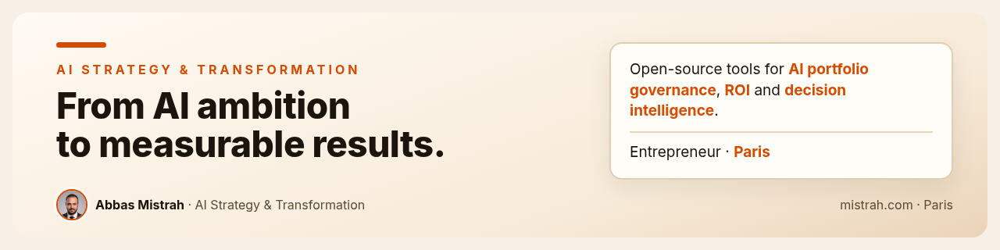

  

  <a href="https://mistrah.com">mistrah.com</a> ·
  <a href="https://medium.com/@abbas_mistrah">Medium</a> ·
  <a href="https://www.linkedin.com/in/abbas-mistrah-b0b53119a">LinkedIn</a> ·
  <a href="https://x.com/Abbas_Mistrah">X</a> ·
  <a href="https://orcid.org/0009-0009-5944-585X">ORCID</a>

## AI Strategy & Transformation

I help leadership teams turn AI ambition into **measurable, trusted results**.

A strategy for AI is not a list of use cases. It is a decision system: **where to focus, who decides, what to measure, what to refuse, and how a pilot becomes a run.**

Entrepreneur based in Paris. The repositories below are the open-source side of my work: tools that make AI portfolios governable and their value provable.

## Selected projects

| Project | What it does |
|:--|:--|
| [**strategy-os**](https://github.com/abbas-mistrah/strategy-os) | Transformation Intelligence & ROI: design strategy, track execution, measure impact, attribute value and prove ROI. |
| [**scale-gate**](https://github.com/abbas-mistrah/scale-gate) | Enterprise AI evidence and scale decision engine: from pilot promise to defensible scale. |
| [**radarline**](https://github.com/abbas-mistrah/radarline) | Local-first Technology & AI Intelligence OS: from information noise to decision-ready signals. |

## Research

- [*It’s Not the Technology*](https://papers.ssrn.com/sol3/papers.cfm?abstract_id=7038158) · SSRN 7038158 · [doi:10.2139/ssrn.7038158](https://doi.org/10.2139/ssrn.7038158)
- [*Eighteen Frameworks, No Evidence*](https://papers.ssrn.com/sol3/papers.cfm?abstract_id=7232782) · SSRN 7232782 · [doi:10.2139/ssrn.7232782](https://doi.org/10.2139/ssrn.7232782)

## Latest writing (English and French)

- [OpenAI's Cyber Model Finds Exploits at Scale. The Number That Matters Is Whether It Stays in Scope.](https://medium.com/@abbas_mistrah/openais-cyber-model-finds-exploits-at-scale-the-number-that-matters-is-whether-it-stays-in-scope-b198095edb1c) · 9 Nov 2026
- [The Best AI Model Scores 12% on Real Expert Work. Build Your AI Roadmap on That Number.](https://pub.towardsai.net/the-best-ai-model-scores-12-on-real-expert-work-build-your-ai-roadmap-on-that-number-7026306678de) · Towards AI · 3 Nov 2026
- [The Era of Unlimited AI Money Is Over. Cheap AI Will Be Paid For, One Way or Another.](https://alt.ctrlmag.com/the-era-of-unlimited-ai-money-is-over-cheap-ai-will-be-paid-for-one-way-or-another-0f06f64e4d9f) · 2 Nov 2026
- [Amazon and JPMorgan Are Blocking AI Agents. Walmart and Google Are Writing the Rules.](https://pub.towardsai.net/amazon-and-jpmorgan-are-blocking-ai-agents-walmart-and-google-are-writing-the-rules-d1539e4fb9f6) · Towards AI · 2 Nov 2026
- [The Pentagon Banned Claude. A Claude Agent Reportedly Ran on Its Network for Two Months Anyway.](https://medium.com/@abbas_mistrah/the-pentagon-banned-claude-a-claude-agent-reportedly-ran-on-its-network-for-two-months-anyway-c41b24cea3a9) · 31 Oct 2026
- [Mistral Large 4 n’est que 36e au classement : la souveraineté ne se gagne pas au score](https://medium.com/@abbas_mistrah/mistral-large-4-nest-que-36e-au-classement-la-souverainet%C3%A9-ne-se-gagne-pas-au-score-eb592fb3f4f4) · 31 Oct 2026 (FR)
- Start here (FR): [De l’ambition IA aux résultats mesurables : 5 décisions de gouvernance](https://medium.com/@abbas_mistrah/de-lambition-ia-aux-r%C3%A9sultats-mesurables-5-d%C3%A9cisions-de-gouvernance-c902e0721094)

[All articles →](https://medium.com/@abbas_mistrah)

---

**L’IA n’est pas un outil. C’est une décision de leadership.** · Abbas Mistrah · Paris
